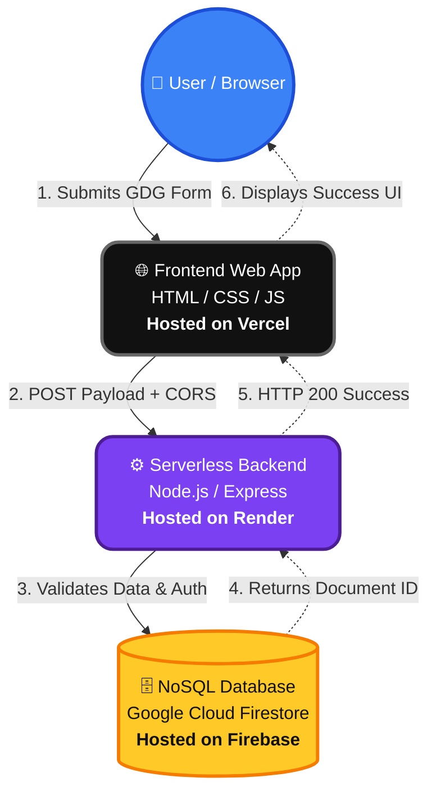
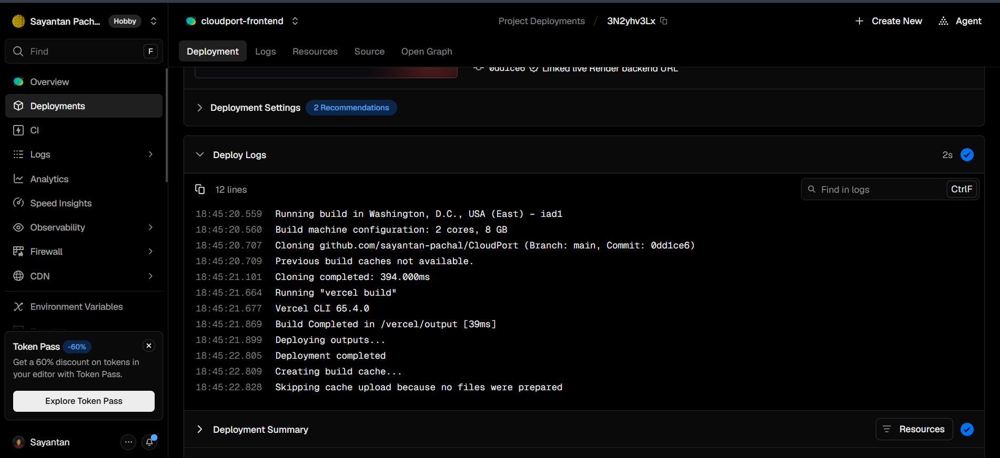
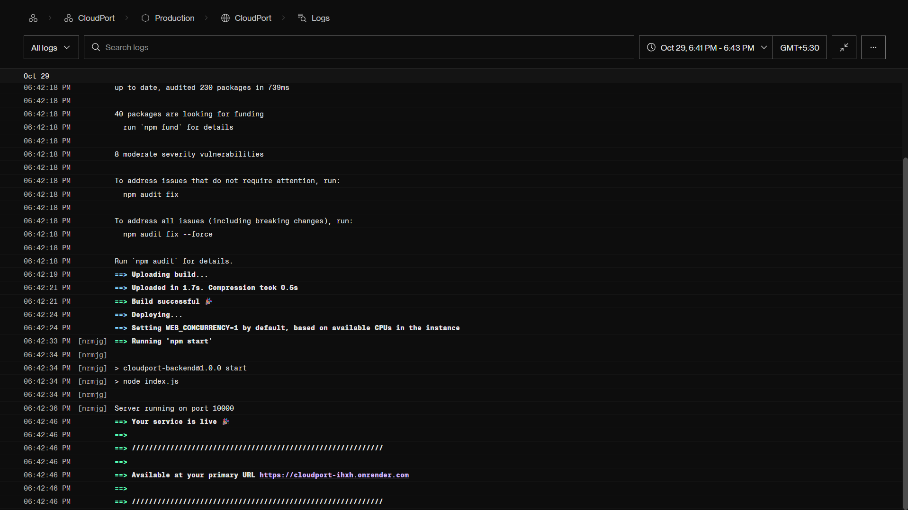
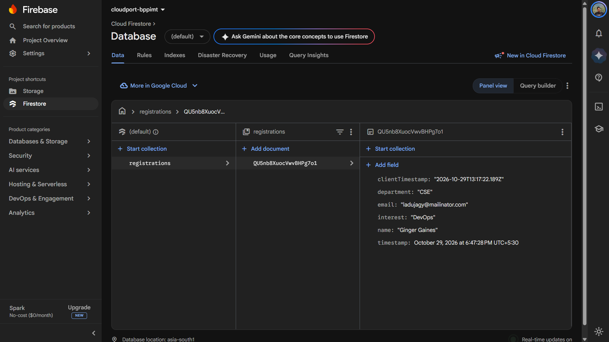

# CloudPort - Serverless Web App & Cloud Integration

## 📌 Project Overview
CloudPort is a lightweight, serverless web registration portal developed for the GDG BPPIMT Cloud Team Selection process. It captures user registration data via a responsive frontend and processes it through a serverless backend API, which securely stores the records in a real-time NoSQL database.

**⚠️ Note on Tech Stack:** Following a direct discussion with the GDG Organizers (Protyoy Bhandary / Sagnik Maitra), explicit approval was granted to pivot the deployment stack from GCP native (Cloud Storage/Cloud Functions) to **Vercel**, **Render**, and **Firebase** due to account billing restrictions, while maintaining the exact required architecture, logic, and Firestore database integration.

## 🚀 Live Links
- **Live Website URL (Frontend):** https://cloudportsp.vercel.app
- **Live API Endpoint (Backend):** https://cloudport-ihxh.onrender.com/register

## 💻 Tech Stack & Architecture
- **Frontend Hosting (Substitute for GCS):** Vercel (Edge Network)
- **Frontend Tech:** HTML5, CSS3 (Glassmorphism), JavaScript (Fetch API)
- **Serverless Backend (Substitute for Cloud Functions):** Render Web Service (Node.js, Express.js)
- **Managed Database:** Google Cloud Firestore (via Firebase)
- **Version Control:** Git, GitHub

### 🏗️ Visual Architecture Diagram
*(Displays the end-to-end flow: Web Form → API Endpoint → Firestore Database)*

## 🛠️ Step-by-Step Deployment Guide

### 1. Frontend Setup & Deployment
1. Built a responsive UI using HTML/CSS/JS without external frameworks.
2. Integrated the backend API URL into the `fetch()` payload logic.
3. Connected the GitHub repository to **Vercel**, setting the root directory to `frontend/`.
4. Deployed to Vercel's global edge network.

### 2. Serverless Backend Deployment
1. Built an Express.js server to handle incoming POST requests and validate payloads (Name, Email, Department, Interest).
2. Implemented strict CORS handling, restricting access exclusively to the Vercel frontend URL to prevent unauthorized API calls.
3. Connected the repository to **Render**, setting the root directory to `backend/`.
4. Injected production Environment Variables (`PORT`, `FRONTEND_URL`, `FIREBASE_PROJECT_ID`, `FIREBASE_CLIENT_EMAIL`, `FIREBASE_PRIVATE_KEY`) directly into the Render dashboard to ensure zero credential exposure on GitHub.

### 3. Database Provisioning (Firestore)
1. Created a new Firebase project and initialized a **Cloud Firestore** database.
2. Generated a secure Service Account JSON private key.
3. Integrated the `firebase-admin` SDK into the Node.js backend to authenticate securely and write form submissions into the `registrations` collection automatically with a server-side timestamp.

## 📸 Proof of Deployment & Console Screenshots

### 1. Active Frontend Deployment (Vercel)

### 2. Deployed Backend Service (Render)

### 3. Live Document Records (Google Cloud Firestore)
